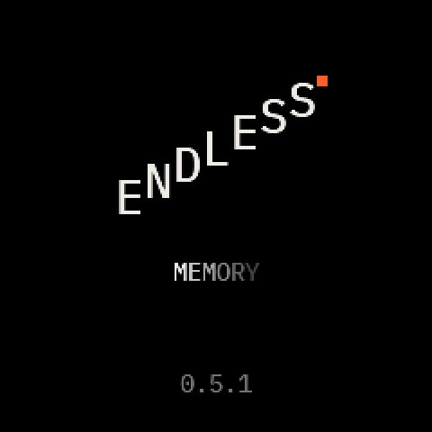
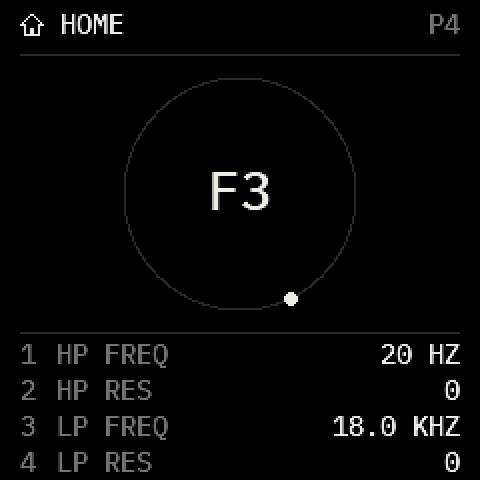
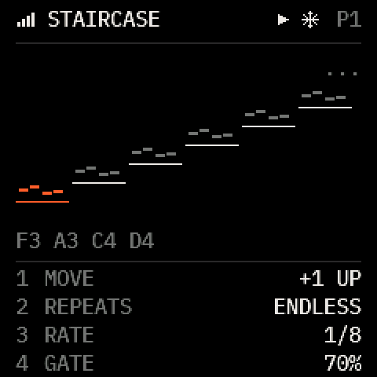
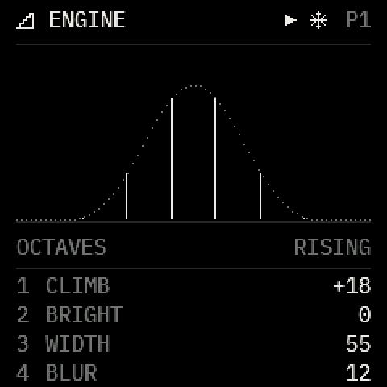

# Endless Memory

  
  

  
  

> [!WARNING]
> **Not tested on a real FM‑1 yet.** Endless Memory has only been tested on a computer and in the online FM‑1 emulator. Install it on your FM‑1 at your own risk, and keep the stock firmware or another firmware ready to flash back.

Endless Memory is a firmware for the **M‑VAVE FM‑1**. Every note is a Shepard
tone, a sound that seems to rise (or fall) for ever, and the sequencer is a
staircase: a short phrase that climbs one step of the scale each time it repeats.

The idea is a calm instrument that never quite arrives. Play a few notes, let the
staircase carry them upward, press **SEL** to freeze what you hold, and shape it
all with a high-pass and a low-pass filter on the home page.

- **Endless engine:** eight partials spaced by octaves, fifths, fourths, tritones, thirds or a stretched interval, under a moving bell of brightness. **CLIMB** keeps them rising or falling without end.
- **Staircase sequencer:** a phrase of up to eight notes that moves by scale steps on every repeat, up or down, for a set number of repeats or endlessly.
- **Freeze, filters and effects:** SEL holds notes like a sustain pedal that stays down. A 2-pole high-pass and low-pass feed a parallel echo and space.
- **26 scales and a root**, an arpeggiator, an LFO, two envelopes, eight presets, and MIDI in and out.

[Read the operator manual](docs/OPERATOR-MANUAL.md) · [Build and test](docs/BUILDING.md) · [Credits and licenses](LICENSING.md)

**Version 0.5.1** builds as `endless-memory-0.5.1.fwsc`. The host tests and the
simulated installer checks passed. It has **not yet been installed on a physical
FM‑1**, so installation and power-cycle persistence still need verification.

## Credits

Endless Memory is designed by [JaakStJaaques](https://github.com/jaak-stjaaques) and built with Claude.

Endless Memory builds on [Dinghy](https://github.com/zvenson/dinghy) by zvenson and the
[Felucca](https://github.com/hugelton/Felucca) and [SLOOP](https://github.com/isod89/sloop-fm1)
platform work it carries. The sound follows the endless scale described by
[Roger Shepard](https://doi.org/10.1121/1.1919362) and the gliding version made
by Jean-Claude Risset. The space effect is built from the comb and all-pass layout
of Jezar's public-domain Freeverb, and the filters use Andrew Simper's
zero-delay state-variable filter. The screen font is
[IBM Plex Mono](https://github.com/IBM/plex).

The firmware is distributed under [GPL-3.0-only](LICENSE). The
[full credits](LICENSING.md) retain the upstream notices and list the separately
licensed assets.
