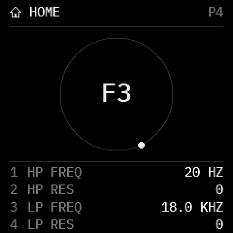
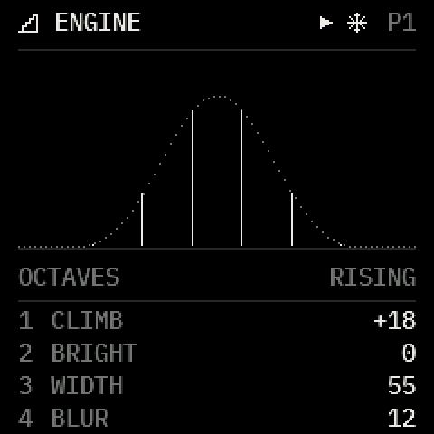
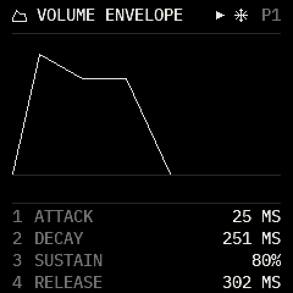
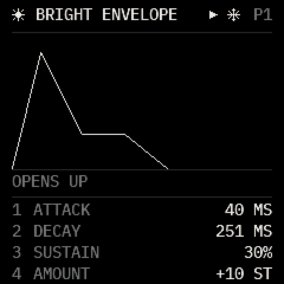
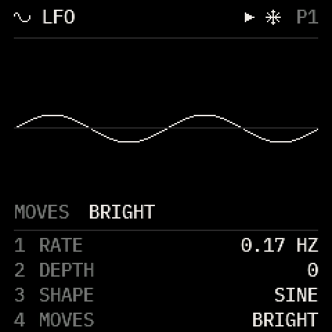
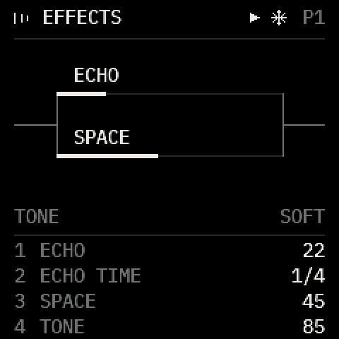
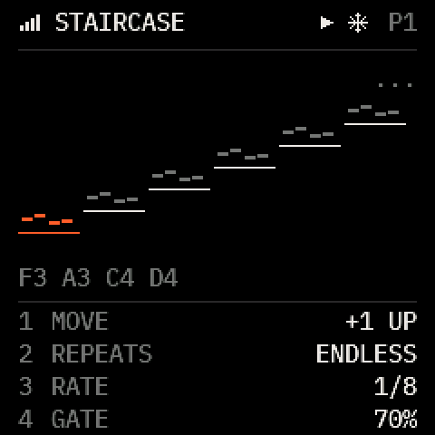
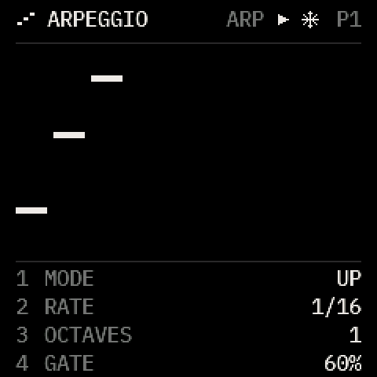
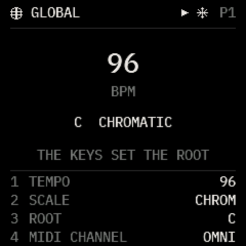
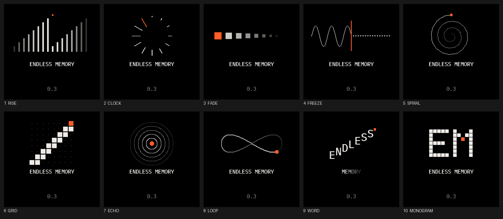

# Endless Memory operator manual

For **Endless Memory 0.5.1** on the **M‑VAVE FM‑1**.

> [!WARNING]
> **Not tested on a real FM‑1 yet.** Endless Memory has only been tested on a computer and in the online FM‑1 emulator. Install it on your FM‑1 at your own risk, and keep the stock firmware or another firmware ready to flash back.

Every note you play is a Shepard tone: eight partials spaced by one interval,
loudest in the middle and fading out at both ends. When the partials move, new ones
fade in at the bottom while old ones fade out at the top, so the sound seems to rise
(or fall) for ever. The sequencer works the same way: a short phrase that climbs one
step of the scale each time it repeats.

Every labelled button does what its label says. Only two have new jobs: **SEL** is
**FREEZE**, and **HOME** opens the filter page.

## Play in a browser

Open the [FM‑1 emulator](https://joakimeriksson.github.io/fm1-emu/), load
`endless-memory-0.5.1.fwsc` and press **Start** to enable audio.

## Install

Download `endless-memory-0.5.1.fwsc` from the [releases](https://github.com/jaak-stjaaques/Endless-Memory/releases)
and install it with the M‑VAVE updater or M‑Flasher like any other FM‑1 firmware.

## Make your first staircase

1. Turn up **MASTER** and play a few keys. **OCT−** and **OCT+** shift the keyboard by octaves.
2. Press **REC**. The screen says *PLAY A NEW PHRASE*. Play two to eight notes. Recording stops by itself after eight, or press **REC** again.
3. Press **PLAY**. The phrase repeats at the tempo, and every repeat moves it by **MOVE** steps of the scale.
4. Press **SEQ** to see the staircase and change **MOVE**, **REPEATS**, **RATE** and **GATE**.
5. Tap **SAVE** to keep the sound and the phrase in the current preset.

Hold **REC** for one second to erase the phrase. Press **PLAY** again to stop.

## The screen

Every page has the same layout: a title with its icon at the top, a picture in the
middle, and the four knobs at the bottom, numbered **1–4** like the knobs on the
panel. The value you last touched turns orange. Messages such as *FREEZE* or
*TEMPO 104* appear briefly in the title.

In the top-right corner, **▶** means the staircase is playing, **✻** means Freeze
is on, an orange dot means REC is on, and **P1–P8** is the preset.

## HOME: the filters

  

**HOME** is the page you start on. The circle shows the last note played, and the
dot on it moves as the partials climb. The four knobs set two 2‑pole filters. The
sound goes through the high-pass first and then the low-pass, before it reaches the
echo and space effects.

| Knob | What it does |
| --- | --- |
| **1 HP FREQ** | High-pass frequency, 20 Hz to 18 kHz. Turn up to thin out the low end. At 20 Hz it is effectively off. |
| **2 HP RES** | High-pass resonance, 0 to 100. Adds a peak at the frequency. |
| **3 LP FREQ** | Low-pass frequency, 20 Hz to 18 kHz. Turn down to darken the sound. At 18 kHz it is effectively off. |
| **4 LP RES** | Low-pass resonance, 0 to 100. Adds a peak at the frequency. |

The resonance is capped, so the filters can ring but never sing on their own.

## SEL: Freeze

Press **SEL** to freeze. Freeze works like a sustain pedal that stays down: the notes
you hold, and the ones you play next, keep sounding after you let go of the keys. Press
**SEL** again to release them. Its LED shows when Freeze is on. A sustain pedal over
MIDI (CC 64) does the same thing.

## EDIT: the Endless engine

  

The picture shows the eight partials as lines under the bell of brightness.
Turn **ALGORITHM** to choose how the partials are spaced: **Octaves**, **Fifths**,
**Fourths**, **Tritones**, **Thirds** or **Stretched**.

| Knob | What it does |
| --- | --- |
| **1 CLIMB** | How fast the partials move, −100 to +100. Positive values rise for ever, negative values fall for ever, 0 stands still. |
| **2 BRIGHT** | Moves the bell up or down, in semitones, so the sound gets brighter or darker. |
| **3 WIDTH** | How wide the bell is: narrow sounds pure, wide sounds full. |
| **4 BLUR** | Detunes the partials against each other for a softer, chorused sound. |

## ENV: the two envelopes

  
  

Press **ENV** for the **Volume envelope** (Attack, Decay, Sustain, Release). Press
**ENV** again for the **Bright envelope**, which moves the bell of brightness during
each note (Attack, Decay, Sustain and **Amount**, in semitones up or down).

## LFO

  

| Knob | What it does |
| --- | --- |
| **1 RATE** | 0.05 to 20 Hz. |
| **2 DEPTH** | How much it moves. At 0 it is off. |
| **3 SHAPE** | Sine, Triangle, Square, Saw, Random (steps) or Drift (smooth random). |
| **4 MOVES** | What it moves: Pitch, Climb, Bright, Width or Volume. |

## FX: Echo and Space

  

Echo and Space run side by side. Both hear the filtered sound, and a limiter at the
end keeps everything from clipping.

| Knob | What it does |
| --- | --- |
| **1 ECHO** | Echo level and feedback together. |
| **2 ECHO TIME** | 1/16, 1/8T, 1/8, 3/16, 1/4, 3/8 or 1/2, following the tempo. |
| **3 SPACE** | Reverb level and size. |
| **4 TONE** | A gentle one-pole tone control on the sound, from Dark to Open. |

## SEQ: the Staircase

  

The picture shows the phrase on each step of the staircase, with the step now
playing in orange. The recorded notes are listed under it. The scale and root on
**GLO** act only on what you hear, so changing them never changes the recording.

| Knob | What it does |
| --- | --- |
| **1 MOVE** | Scale steps per repeat, from 7 down to 7 up. *STAY* repeats in place. |
| **2 REPEATS** | 1 to 16 repeats before it starts again from the bottom, or **Endless**. |
| **3 RATE** | 1/4, 1/8, 1/8T, 1/16, 1/16T or 1/32. |
| **4 GATE** | How long each note lasts, 5 to 100%. |

When the staircase has climbed an octave it quietly drops back an octave. The
endless sound hides the jump, so the melody seems to keep climbing.

## ARP: the arpeggiator

  

Press **ARP** to turn the arpeggiator on or off. It plays the keys you hold (or have
frozen) at the tempo. **MODE** chooses Up, Down, Up‑down, Random, As played or Chord.
**RATE**, **OCTAVES** (1–4) and **GATE** work as on the staircase.

## GLO: tempo, scale, root and MIDI

  

| Knob | What it does |
| --- | --- |
| **1 TEMPO** | 40 to 240 BPM. **SELECT** changes the tempo from any page. |
| **2 SCALE** | 26 scales, from Chromatic, Major and Minor to Hijaz, Bhairav, Hirajoshi, In Sen, Pelog and Prometheus. |
| **3 ROOT** | Transposes everything by −12 to +12 semitones. |
| **4 MIDI CHANNEL** | Omni or 1–16. |

On this page the keys set the root instead of playing notes.

## Presets and saving

Turn **PRESETS** to choose one of eight sounds: **Endless**, **Descent**, **Organ**,
**Fifths**, **Tritone**, **Glass**, **Pulse** and **Dust**. Each one has its own phrase.

Tap **SAVE** to save the sound and phrase to the current preset. To save somewhere
else, hold **SAVE**, turn **PRESETS** to the slot you want, and let go.

## Shortcuts

- Hold any page button and turn a knob to change that page. When you let go, the screen goes back to where you were.
- MIDI in and out over USB and the TRS jack, with clock in, start and stop. Pitch bend is ±2 semitones.

## Boot logos

  

Version 0.5.1 starts with **Word**: ENDLESS climbs a step per letter, and MEMORY
fades letter by letter. Nine other logos are built in. To choose another, build
with `DINGHY_DEFS="-DEM_LOGO=n"`, where `n` runs from 0 (Rise) to 9 (Monogram).
